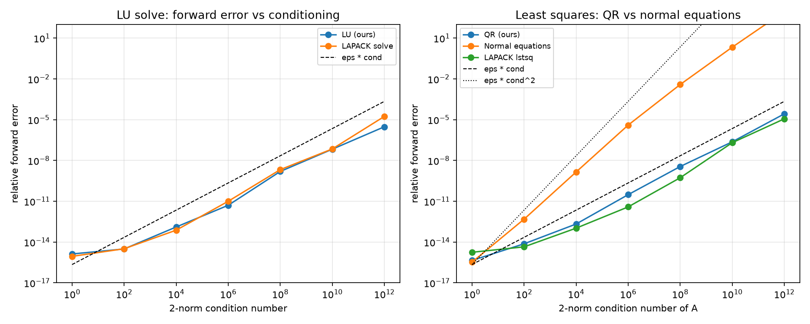
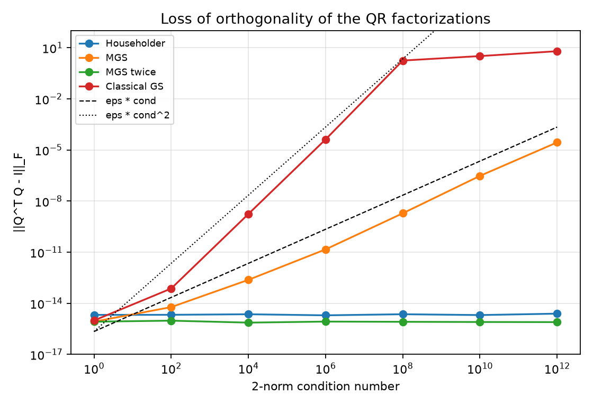
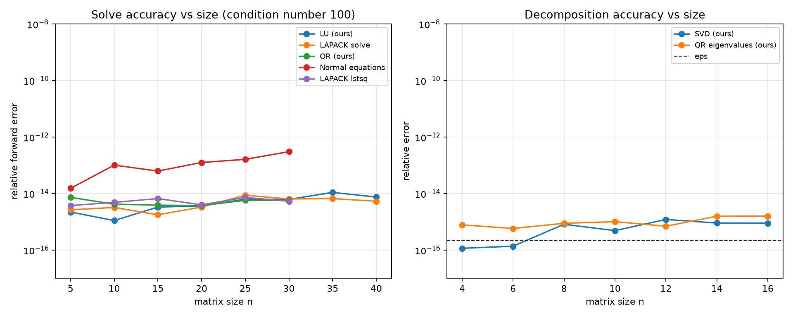
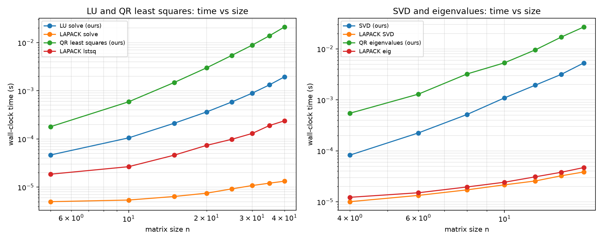

# numlib

[](https://github.com/IkerAbad/numlib/actions/workflows/ci.yml)
[](https://pypi.org/project/numlib-linalg/)
[](LICENSE)
[](https://www.python.org/)

Dense numerical linear algebra implemented from scratch in Python. The
algorithms operate on plain lists of floats; NumPy is used at the input/output
boundary and in the benchmarks and verification scripts.

The PyPI distribution is **`numlib-linalg`** because the name `numlib` is
already registered by an unrelated number-theory package. The import package
is still `numlib`.

## What is implemented

| Module | Method | Notes |
| --- | --- | --- |
| `numlib.lu` | Gaussian elimination, partial and complete pivoting | `P A Q = L U`, growth factor, triangular solves |
| `numlib.qr` | Householder reflections | Backward stable, orthogonality at machine precision |
| `numlib.qr` | Modified Gram-Schmidt, optional reorthogonalization | Cheaper; loses orthogonality like `cond(A) * eps` |
| `numlib.qr` | Classical Gram-Schmidt | Included to show the `cond(A)^2 * eps` loss |
| `numlib.svd` | One-sided Jacobi rotations | High relative accuracy, no bidiagonalization |
| `numlib.eigen` | Hessenberg reduction + Wilkinson / Francis QR | Eigenvalues, real Schur form, right eigenvectors |
| `numlib.eigen` | Inverse iteration on the Schur form | Householder accumulation plus block back substitution |
| `numlib.lstsq` | Least squares by Householder QR and normal equations | Compares `cond(A)` with `cond(A)^2` |
| `numlib.pca` | Principal components from a covariance matrix | Explained variance and loadings |
| `numlib.analysis` | Condition number, forward and backward error | `cond_2` estimated with the package SVD |
| `numlib.generators` | Hilbert, Vandermonde, Gaussian, prescribed condition, Wilkinson | Reproducible with explicit seeds |
| `numlib.benchmark` | Comparisons against `numpy.linalg` | Relative error, backward error, wall-clock time |

## Install

```bash
pip install numlib-linalg
```

From a clone, with the development tools:

```bash
git clone https://github.com/IkerAbad/numlib.git
cd numlib
python3.12 -m venv .venv
source .venv/bin/activate        # Windows: .venv\Scripts\activate
python -m pip install -e ".[dev]"
```

Python 3.12 or newer is required. NumPy is the only runtime dependency.

## Quick start

```python
import numpy as np

from numlib import eigen_qr, pca, solve

A = np.array(
    [
        [4.0, -2.0, 1.0],
        [-2.0, 4.0, -2.0],
        [1.0, -2.0, 4.0],
    ]
)
b = np.array([11.0, -16.0, 17.0])

print("solution:", solve(A, b))

result = eigen_qr(A)
print("eigenvalues:", result.values)
print("eigenvectors:", result.vectors)
print("residuals:", result.residuals)

vectors = np.array(result.vectors)
residual = A @ vectors - vectors * np.array(result.values)
print("max eigenvector residual:", np.max(np.abs(residual)))

covariance = [
    [4.0, 2.4, 1.2],
    [2.4, 3.0, 0.9],
    [1.2, 0.9, 1.0],
]
components = pca(covariance)
print("explained variance:", components.explained_variance_ratio)
print("cumulative variance:", components.cumulative_variance_ratio)
```

## Eigenvalues and eigenvectors

`eigen_qr` returns the eigenvalues, the real Schur form `T`, the accumulated
orthogonal matrix `Q` and the right eigenvectors. The QR iteration accumulates
every Householder transformation, and the eigenvectors of `T` are obtained by
inverse iteration on the quasi-triangular Schur form. The eigenvector of the
original matrix is `x = Q y`. The method, its complexity and its limits are
documented in [`docs/eigenvectors.md`](docs/eigenvectors.md).

```python
from numlib import eigen_qr

matrix = [[2.0, 1.0], [1.0, 2.0]]
result = eigen_qr(matrix)
print(result.values)  # [1.0, 3.0]
print(result.vectors)  # columns are eigenvectors
print(result.residuals)  # relative Schur residual per column
```

For a matrix with repeated or defective eigenvalues the individual vectors are
not unique. A defective eigenvalue has fewer independent eigenvectors than its
algebraic multiplicity, so the returned matrix cannot be a basis; its rank and
condition number show the deficiency, while the residual still measures
`A v = lambda v`.

```python
from numlib import eigen_qr

jordan = [[1.0, 1.0], [0.0, 1.0]]
result = eigen_qr(jordan)
print(result.values)  # two copies of 1.0
print(result.residuals)  # both columns satisfy A v = lambda v
print(result.vectors)  # the two columns are nearly parallel
```

`eigenvalues(A)` skips the inverse iteration when only the spectrum is needed.

## Principal component analysis

`pca` takes a symmetric covariance matrix and returns eigenvalues, component
loadings, explained variance ratios and cumulative ratios. The implementation
uses the package eigensolver; NumPy is not involved in the computation.

```python
from numlib import pca

covariance = [
    [4.0, 2.4, 1.2],
    [2.4, 3.0, 0.9],
    [1.2, 0.9, 1.0],
]
result = pca(covariance)
print(result.eigenvalues)
print(result.explained_variance_ratio)
print(result.cumulative_variance_ratio)
print(result.components)
```

The runnable example [`examples/pca.py`](examples/pca.py) builds the covariance
matrix of a hand-written eight-observation, three-variable data set (temperature,
humidity and energy use), compares the result with `numpy.linalg.eigh` and
prints the explained variance:

```bash
python examples/pca.py
```

## Figures

The figures are regenerated from measured runs with:

```bash
python scripts/make_figures.py
```

The command writes four PNG files under `figures/`. The CI workflow also runs
it and uploads the images as build artifacts.

### Error versus condition number



LU tracks the `cond(A) * eps` line. In least squares, QR follows
`cond(A) * eps`, while the normal equations follow `cond(A)^2 * eps` and lose
accuracy much earlier.

### Loss of orthogonality



Householder QR stays at machine precision for every condition number tested.
MGS grows like `eps * cond(A)`, one reorthogonalization restores the
Householder level, and classical Gram-Schmidt grows like `eps * cond(A)^2`.

### Error versus size



For well-conditioned matrices the relative error stays near machine precision
as the size grows. The SVD and the symmetric QR eigensolver show the same
behavior.

### Time versus size



The pure-Python implementation is slower than LAPACK, as expected from scalar
loops against compiled, blocked kernels. The comparison is indicative and
depends on the BLAS build and threading configuration.

## Measured results

The README does not hand-copy measurements. Every quantitative result is
generated by a versioned script:

```bash
python scripts/generate_report.py
```

This writes [`docs/RESULTS.md`](docs/RESULTS.md) and
[`docs/eigenvector_verification.json`](docs/eigenvector_verification.json). The
report contains:

- the relative eigenvalue and eigenvector error against `numpy.linalg.eig` for
  known, random, symmetric, repeated and defective matrices;
- the eigenvector residuals, rank and condition number for the defective and
  repeated cases;
- the explained variance and loadings of the hand-built PCA covariance matrix,
  with the difference against `numpy.linalg.eigh`.

## Reproducing the checks

```bash
ruff check .
ruff format --check .
mypy
pytest
python scripts/make_figures.py
python scripts/generate_report.py
```

The test suite includes unit tests, property tests for `A = Q R`,
`A = U diag(S) V^T` and `P A Q = L U`, eigenvector tests for symmetric,
repeated and defective matrices, and the LAPACK accuracy checks.

## Package name

PyPI already hosts an unrelated project named `numlib` (a number-theory
package, version 0.3.1). This project is therefore published as
**`numlib-linalg`**, version **0.1.0**, while the import package remains
`numlib`:

```bash
pip install numlib-linalg
python -c "import numlib; print(numlib.__version__)"
```

The GitHub repository keeps the name `numlib`; the PyPI project page is
<https://pypi.org/project/numlib-linalg/>.

## Project layout

```text
numlib/
├── .github/workflows/ci.yml
├── CHANGELOG.md
├── docs/
│   ├── eigenvectors.md
│   └── RESULTS.md              # generated
├── examples/pca.py
├── figures/
├── scripts/
│   ├── generate_report.py
│   └── make_figures.py
├── src/numlib/
│   ├── analysis.py
│   ├── benchmark.py
│   ├── eigen.py
│   ├── generators.py
│   ├── lstsq.py
│   ├── lu.py
│   ├── pca.py
│   ├── qr.py
│   └── svd.py
└── tests/
```

## Scope and limitations

- Dense matrices only. Sparse matrices, parallelism and GPU execution are out
  of scope.
- The algorithms are written for readability, not speed. Pure-Python `O(n^3)`
  loops are practical only at moderate sizes.
- The eigensolver returns right eigenvectors, not left eigenvectors.
- For defective eigenvalues there is no complete eigenbasis. The returned
  matrix has rank smaller than `n`; the residual and condition number describe
  the situation instead of hiding it.
- For non-normal matrices the eigenvectors are not orthogonal; a large
  `||V^H V - I||` is expected.
- No iterative refinement, scaling or equilibration is applied.
- The timing comparison uses the LAPACK build and threading configuration
  installed with NumPy; it is not a controlled BLAS benchmark.

## License

MIT. Copyright (c) 2026 Iker Abad.
